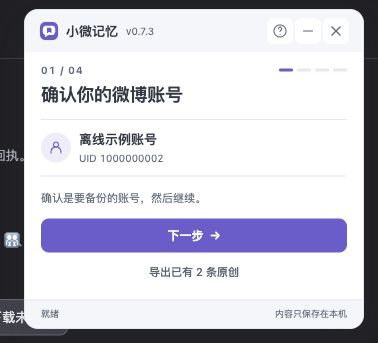
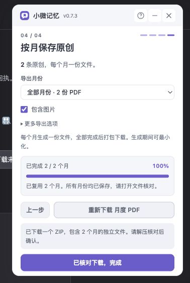

<p align="center">
  
</p>

# 小微记忆 · xiaowei-memory

把微博留在自己的笔记里。一个在微博页面内打开的小工具：**过滤转发，按月保存原创，每月一份 PDF，多个月份统一打包为一个 ZIP。**

本地优先的 Chrome / Edge 桌面扩展，无需额外注册账号或部署服务器。当前版本为 **v0.7.3 试用版**：已有纯逻辑、模拟接口和离线预览验证，已安装扩展在真实账号上的完整验收仍待完成。微博网页接口可能变化，工具不承诺取得账号全部历史。

<p align="center">
  
  
</p>

截图使用离线合成账号与模拟下载回执，不包含真实用户数据。

## 能做什么

- **四步完成备份**：确认账号 → 选择范围 → 采集进度 → 导出。面板约 340px 宽，可最小化、关闭和重新打开。
- **只导出原创**：自动过滤转发，按北京时间归月，保留正文、时间、原文链接及可选图片、表情。
- **按月生成、统一打包**：先逐月生成 PDF 并暂存到本地磁盘，再流式打包；显示月份生成、打包和下载的整体进度。
- **失败后继续**：在相同账号、月份、格式、图片选项及内容修订下，重试会复用已经完整生成的月份。失败详情可定位具体微博和图片地址。
- **兼容旧图片地址**：受支持的新浪图片 HTTP / `//` 地址在请求时升级为 HTTPS，并兼容两个旧表情域名。
- **可选 Markdown**：导出月笔记与本地图片，适合放入 Obsidian；不直接修改笔记仓库。
- **数据保存在本机**：无遥测、广告或开发者数据接收服务器，PDF 库和中文字体随扩展打包。

## 安装

### 从源码安装

1. 在本仓库选择 **Code → Download ZIP** 并解压到固定目录，或运行：

   ```sh
   git clone https://github.com/fangkn/xiaowei-memory.git
   ```

2. Chrome 打开 `chrome://extensions`，Edge 打开 `edge://extensions`，开启「开发者模式」。
3. 点击「加载已解压的扩展程序」，选择项目内的 **`extension`** 文件夹；这一层应直接包含 `manifest.json`。
4. 固定扩展图标，登录微博，在自己的个人主页点击「小微记忆」。

安装已有源码不需要运行 npm。需要自行制作安装包时，执行下文构建命令。

### Chrome 与 Edge 安装包

运行 `npm run build` 会同时生成两种 ZIP：

| 浏览器 | v0.7.3 安装包 | 可直接加载的目录 | 扩展管理页 |
| --- | --- | --- | --- |
| Chrome | `dist/xiaowei-memory-chrome-v0.7.3.zip` | `dist/chrome` | `chrome://extensions` |
| Edge | `dist/xiaowei-memory-edge-v0.7.3.zip` | `dist/edge` | `edge://extensions` |

本地安装时先解压 ZIP，再进入对应管理页，打开「开发者模式」，选择「加载已解压的扩展程序」并选中包含 `manifest.json` 的目录。两个 ZIP 共用兼容的 Manifest V3 代码，包内根目录直接包含 Manifest，也可用于对应商店提交；生成 ZIP 不代表已经上架或通过商店审核。

通用包 `dist/xiaowei-memory-extension.zip` 和目录 `dist/unpacked` 继续保留。已安装用户升级时保持原加载目录，参见下面的升级说明。

### 升级已有安装

先暂停任务并导出重要内容，用新版文件更新**原来加载的同一个扩展目录**，在扩展管理页点击重新加载，再刷新微博页面。不要先卸载、清除扩展数据或改换安装目录；这些操作可能导致本地记录丢失或生成另一份扩展。

扩展更新后，旧浮窗可能提示 `Extension context invalidated.`。刷新微博并重新点击扩展图标即可重新连接。已经落盘的记录保留；使用相同的导出设置，可恢复有效的月份临时文件。

## 使用

1. **打开个人主页**：登录微博，进入自己的数字 UID 主页，例如 `https://weibo.com/u/你的数字UID`。微博首页不是个人主页。
2. **确认并采集**：点击扩展图标，确认账号，选择当前页面或指定月份。指定月份为实验功能，只查询用户确认的范围。
3. **查看进度**：可暂停或最小化。采集和生成时保留微博标签页；刷新、离开或关闭标签页会中断正在运行的任务。
4. **导出并核对**：选择月份及是否包含图片，按浏览器提示授予图片读取权限。单月下载 PDF，多月生成一个 ZIP，解压后每月一份 PDF。检查正文与图片后，点击「已核对下载，完成」。

下载位置由浏览器设置或保存对话框决定，可在浏览器下载记录中找到。生成过程中的文件暂存在扩展私有磁盘空间，只有最终下载的文件才是可自行移动的备份。

图片失败时展开「查看失败详情」，修复可恢复的问题后点击「重试未完成月份」。完整月份会复用，临时文件缺失、设置改变或内容变化时需要重新生成。已删除、无权访问或失效的源图片无法保证恢复；旧记录只有表情文字而没有图片地址时，需要重新采集相应微博。

更完整的操作和故障处理见 [使用说明](小微记忆-使用说明.md)。

## 数据、权限与限制

| 权限 | 用途 |
| --- | --- |
| `activeTab`、`scripting` | 用户点击图标后，在指定微博页显示面板、读取内容及执行用户启动的同源历史查询 |
| `storage` | 支持扩展本地存储；采集记录实际保存在 IndexedDB |
| `downloads` | 用户发起 PDF / ZIP 下载，并核对该次下载的状态 |
| `declarativeNetRequestWithHostAccess` | 读取新浪图片时，临时为本扩展的请求补充固定微博 Referer |
| 可选新浪图片主机权限 | 用户选择包含图片时，读取 `*.sinaimg.cn`、`img.t.sinajs.cn`、`face.t.sinajs.cn` |

图片请求会访问新浪 CDN；工具不读取或导出 Cookie、密码或登录令牌。正文与导出文件在本机生成。分享诊断前请自行移除账号、原文链接及图片 URL 中的个人信息；本机失败详情可能保留完整查询参数。详情见 [隐私与权限](PRIVACY.md)。

- **“完整月快照”指本机已保存的该月记录**，不是源站全量证明。自动滚动结束、空页或范围遍历完成，都不能证明无遗漏。
- 视频只保留原帖链接，不备份视频文件、评论、点赞列表或私信。图片可能是页面预览尺寸，不保证原图；动态图在 PDF 中保存为静态图。
- 全任务已取消 128 MiB 上限，但仍需要足够磁盘空间。单张图片上限 12 MiB、单月图片总量 64 MiB、单月 PDF 96 MiB；最终 ZIP 使用 ZIP32，不能超过其约 4 GiB 限制。达到限制会明确报错，需缩小范围或调整导出选项。
- 为避免中文缺字，每份 PDF 嵌入完整字体，纯文字文件基础大小约 6.2 MiB。
- 卸载或清除扩展数据会删除本地记录和临时任务；已下载文件不会随之删除。目前没有完整数据库导入恢复功能。
- 本项目为非官方工具，与微博没有隶属关系。请用于自己有权保存的内容，并自行决定备份的分享范围。

## 开发

需要 Node.js 20 或更新版本。运行时使用原生 JavaScript ES modules；依赖库和字体位于 `extension/vendor`、`extension/fonts`，扩展运行时不从 CDN 加载代码。

```sh
npm ci
npm run check
npm test
npm run build
```

构建输出位于 `dist/`。通用构建只生成本项目产物，不修改已安装扩展的其他目录。

只打包某一种浏览器时：

```sh
npm run build:chrome
npm run build:edge
```

这两个命令各自生成对应的版本 ZIP、`dist/chrome` 或 `dist/edge` 目录，以及源码 ZIP，不改写另一个浏览器已有的包。CI 的构建产物包含两种浏览器 ZIP。

浏览器 DOM fixture 测试使用锁定的 Playwright 开发依赖：

```sh
npx playwright install chromium
npm run test:browser
```

离线交互预览：

```sh
npm run preview
```

打开终端提示的 `http://127.0.0.1:4178`。预览使用合成账号和模拟数据，不连接真实微博，也不读取已安装扩展的数据；其下载回执可为模拟结果。预览和 DOM fixture 通过不等于正式扩展安装验收通过。

| 目录 / 模块 | 内容 |
| --- | --- |
| `extension/content.js`、`history-*.js` | 页面采集、历史查询和页级检查点 |
| `extension/model.js`、`record-store.js`、`monthly.js` | 本地记录、内容版本与月度修订 |
| `extension/export-runner.js`、`export-files.js`、`zip-stream.js` | 逐月生成、恢复、OPFS 暂存和统一 ZIP |
| `extension/monthly-pdf.js`、`archive.js` | PDF 与 Markdown 归档 |
| `extension/media-*.js` | 图片地址、响应校验和来源兼容 |
| `extension/floating-panel.js`、`panel-ui.js`、`dashboard.js` | 悬浮面板、向导与任务交互 |
| `tests/`、`scripts/` | 回归测试、离线预览和构建检查 |

参与开发前请阅读 [贡献指南](CONTRIBUTING.md)。验证范围见 [测试报告](TEST-REPORT.md)，后续计划见 [路线图](docs/ROADMAP.md)。

## 反馈与许可

问题与建议请提交到 [Issues](https://github.com/fangkn/xiaowei-memory/issues)。不要公开上传 Cookie、私密微博、完整备份或未脱敏诊断；安全问题请按 [安全报告说明](SECURITY.md) 联系维护者。

项目采用 [MIT License](LICENSE)。第三方代码与字体沿用各自许可，见 [第三方声明](extension/THIRD_PARTY_NOTICES.md) 与 [依赖来源和校验](docs/DEPENDENCIES.md)。版本变化见 [CHANGELOG](CHANGELOG.md)。
