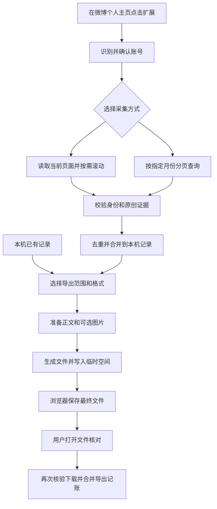

# 小微记忆工作逻辑

小微记忆先从微博个人主页或指定月份查询中读取内容，把可识别的记录保存到浏览器本机，再从这些记录生成 PDF 或 Markdown 备份。采集和导出是两个阶段：可以分多次采集，也可以直接导出本机已有内容。

本文对应 2026 年 11 月 8 日 v0.7.6 的实现，包含「PDF（全部合成一份）」及 Markdown 月份目录导出。理解结果时要区分三件事：**已采集表示记录已经保存到本机；下载完成表示浏览器已报告该次文件保存完成；确认完成表示用户核对文件后记下了这次导出的版本。** 这些状态都不等于微博账号全部历史已取得。

## 整体流程

核心规则是：记录保存成功后才能推进采集进度；导出以选定时的内容快照为准；所有选中内容的文件和附件满足完成条件后，才允许确认并记账。

## 账号识别与界面状态

用户点击工具栏图标后，后台只向当前微博标签页注入悬浮面板。面板从浏览器取得来源标签页，不依赖手工输入的 UID 来指定任意页面。

连接时检查 HTTPS 的数字 UID 个人主页，支持 `weibo.com` 和 `www.weibo.com` 下的 `/u/数字UID`、`/数字UID`。随后扫描页面确认 UID、昵称及登录或访问限制。微博信息流首页和单条微博详情页不能作为采集入口。

账号卡片优先使用主页头像区的图片，也可回退到 UID 明确匹配的本人微博作者头像。导航、推荐、评论和转发头像不会作为候选。头像地址只接受新浪图片 CDN，旧 HTTP 或协议相对地址升级为 HTTPS；地址与 UID 一起保存到已有账号设置中，无需数据库升级。相同账号可复用上次头像，切换账号立即清除旧图；图片加载失败显示默认图标，迟到的旧图片请求不能覆盖新账号。头像不写入微博正文或导出文件。

若首次识别时头像尚未挂载，面板会在后台最多补读 5 次主页资料，不滚动页面或开始采集；页面采集的后续扫描也会补充新头像。每次补取都核对连接版本及 UID，切换账号或页面受限后停止；图片节点在同一账号、同一地址仍在加载或已显示时复用，失败后允许重试。头像缓存以事务核对账号，防止其他浮窗的迟到更新覆盖当前账号。

| 界面步骤 | 可执行的动作 | 进入下一步的条件 |
| --- | --- | --- |
| 确认账号 | 识别来源主页，或导出本机已有记录 | 新采集需要连接成功；直接导出需要本机有原创记录 |
| 选择范围 | 选择当前页面或指定月份 | 开始时重新检查来源账号；账号变化则返回确认 |
| 采集进度 | 查看保存数量、暂停、继续、进入导出 | 暂停要等当前读取收尾；有记录才能导出 |
| 导出备份 | 选择格式、月份、图片，下载并核对 | 下载及附件满足要求后才能确认 |

准备、采集、停止收尾、生成和确认过程中，界面会锁定冲突操作。浏览器锁分别限制同时进行的采集和导出，避免多个浮窗各自启动同类任务。最小化保留面板和任务；刷新或离开微博页面会中断正在运行的任务。

指定月份模式要求勾选自己的账号并同意使用当前登录态。这是用户确认，插件没有据此自动认证登录者身份。连接失败时，本机记录仍可用于导出；若需要补取图片，仍需图片权限和可用的图片源。

## 两种采集方式

### 当前页面采集

页面模式读取浏览器已经展示的微博卡片，流程如下：

1. 尝试点击当前页面可原地展开的正文按钮，每轮最多 15 个，等待约 700 毫秒。
2. 读取卡片中的作者 UID、可靠的微博 ID、正文、时间、原文链接、照片、表情和转发证据。
3. 只保存目标账号的可识别记录。无法可靠确认微博 ID 的卡片计入未解析，不编造 ID。
4. 本轮保存完成后，如果开启自动滚动，向下滚动约 80% 屏高，等待 2.5 至 3.2 秒，再读下一轮。
5. 关闭自动滚动时读完本屏就停止；连续 6 轮没有新增或更新、也没有本轮任务首次见到的帖子时结束本轮采集。

首次遇到的转发也算“见到新帖子”，因此连续出现转发不会立即触发无变化停止条件。页面出现登录限制或切换到别的账号时暂停。

页面停止表示暂时读不到新内容。微博虚拟列表可能回收卡片，工具也没有保存精确的滚动位置；恢复时继续扫描并去重，不能把停止滚动理解为全历史采集完成。

页面采集的总条数未知，运行中显示活动动画。本轮正常结束且已有记录时，显示满条和「可以导出了」，只表示本轮内容已保存；手动暂停或读取异常时隐藏进度条，显示对应状态，已保存内容仍可导出。继续采集会清除本轮结束状态、恢复动画，空记录不会显示完成。该界面状态不改动数据库和采集检查点；月份模式继续按真实月份遍历数量显示进度。

### 指定月份采集

月份模式生成从起始月到结束月的逐月计划，每个月从第 1 页开始。范围按北京时间计算，最早 2009 年 1 月，结束月份不能晚于当前月。年月目录只供参考，目录里没有列出的月份仍会查询。

查询在来源微博页面中执行，使用当前页面的同源登录态，仅允许固定的目录、月份搜索和长文 GET 请求。当前历史接口入口要求 `https://weibo.com` 数字 UID 主页；连接支持的 `www` 地址不等于历史查询也支持该地址。

每页处理顺序是：校验响应 → 标准化记录 → 记录未知日期或越界情况 → 判定原创 → 必要时补取原创长文 → 保存本页记录 → 保存下一页检查点。

只有本页处理成功后才增加页码。若第 3 页保存了前两条后失败，检查点仍停在第 3 页；继续时重读这一页，已保存的两条通过主键合并，不会因此复制成两条微博。长文补取失败时，先保留已经拿到的不完整正文，再暂停等待重试。

| 返回情况 | 处理结果 |
| --- | --- |
| 成功响应中有正常列表 | 处理本页，保存成功后进入下一页 |
| 同一页两次明确的成功空列表 | 结束当前月份，进入下一个月 |
| 缺少列表、错误 JSON、登录限制、限流或请求异常 | 暂停在原页，不当成空列表 |
| 重复返回已读页，或整页日期都在请求月份之外 | 暂停并记录覆盖异常 |
| 日期未知或部分记录越界 | 保存可识别的原创，同时记录异常，不凭空修正日期 |

所有月份遍历完后，状态是 `range-traversed-unverified`，表示范围已遍历但完整性未核验。覆盖报告保留已读页、空页证据、未知日期、越界和失败信息，`allHistoryGuaranteed` 始终为 `false`。

## 原创判定与本机记录合并

### 原创判定

页面采集根据实际引用内容识别转发，不把卡片底部的“转发”操作按钮当成证据；接口采集检查 `retweeted_status` 等字段。统一判定还会检查当前记录及其历史观察：存在转发正文、转发链接、不可访问的转发内容或新版明确转发标记时，会排除该记录。

因此，后来看到一张折叠卡片、暂时读不到引用内容，不能抹掉以前已经观察到的转发证据。旧版只有孤立转发标记、没有其他证据的误判，可以被新版可靠观察纠正。

第一次遇到的转发不会新增到记录库。如果某条记录以前误判为原创、已经保存，重新采集发现转发后会更新该记录的证据，保留观察历史，并从后续原创导出中排除。已经下载的旧文件不会自动改写，需要重新导出。

### 去重与正文保护

一条微博以 `UID:微博ID` 为主键，内容指纹用来判断正文、时间、作者和媒体等是否变化。重复读取同一条时更新观察时间；内容发生变化时保存旧快照，历史快照按内容指纹去重。

已保存的完整正文不会被后来读到的截断正文覆盖。新的截断观察仍单独保留在历史中。已有可靠时间不会被缺失时间或粗略的相对时间估计覆盖。源站不再返回某条微博，也不会触发本机删除。

旧移动页面的纯数字 ID 仅在接口给出精确字符串对应关系、且旧记录没有可靠身份来源时迁移。先成功保存规范记录及历史，再删除旧别名；缺少对应证据时保留记录并提示可能重复，不猜测转换。

## 导出范围与三种文件格式

导出只读取本机已经保存的微博记录。顺序为：按目标 UID 筛选 → 排除转发 → 按北京时间归月 → 应用起止月份 → 应用可用的增量筛选 → 选择某个月或“全部月份”。

日期未知的记录保留为独立候选组，不会被起止月份静默丢弃。选择“全部月份”会包含这个组；只选择一个已知月份时，不会额外带入未知日期组。

**“全部月份”指当前筛选范围内、本机已有的全部月份。** 设置了起止月份后，它不会越过该范围读取其他已知月份，也不会自动向微博补采遗漏内容。

| 文件格式 | 内容组织 | 最终下载 | 失败后恢复 |
| --- | --- | --- | --- |
| PDF 每月一份 | 每月一份当前原创正文，附时间、链接及可选图片和表情 | 单月是 PDF；多月是一个 ZIP，内含各月 PDF 和清单 | 复用完整月文件，重新生成失败或临时文件缺失的月份 |
| PDF 全部合成一份 | 所选内容按时间排序、按月分节，未知日期放在最后，连续编号和页码 | 一个可直接打开的 PDF | 完整文件可复用；附件失败或临时文件缺失时重新生成整本 |
| Markdown 加图片 | 每月一个目录，包含主笔记、可选历史观察档、图片和本月清单；有历史任务时附覆盖报告 | 单月或多月均下载一个 ZIP，只选一次保存位置；内含月份目录和总清单，解压一次即可阅读，没有月份 ZIP 嵌套 | 按月份复用或重做，再流式写入最终 ZIP |

合并 PDF 在同一个文档中直接排版，共用一份中文字体及素材，不先生成多个 PDF 再拼接。两种 PDF 都使用当前保存的原创正文；历史观察正文单独保留在 Markdown 的月历史档中。导出不会直接修改 Obsidian 仓库，也不会覆盖用户已经写过的批注。

Markdown 目录示例为 `2026-03/2026-03.md`、`2026-03/2026-03-history.md`、`2026-03/assets/Rdemo1/01.jpg` 和 `2026-03/manifest.json`。未知日期使用 `未知日期/未知日期.md`；每月还有导入说明，存在历史任务时附 `history-coverage.json`。主笔记与历史档用相对链接双向跳转，图片使用同目录下的 `assets/...`，历史图片放在 `assets/微博ID/versions/序号/`。将完整月份目录放入 Obsidian 仓库即可保留这些链接；块引用使用新的月笔记路径，例如 `[[2026-03/2026-03#^条目中的块ID]]`。主笔记和历史档中的稳定块 ID 保持不变。

PDF 在排版时将已有正文中可识别的昵称、话题及超话名称恢复为超链接，隐藏附带的长网址，只在 PDF 注释中保留点击目标。无法可靠恢复名称时保留原文；不改写数据库中的正文或历史。原文入口也使用短标签。标题、月份分节、时间栏、正文及页码采用统一样式。

### 月度增量的含义

月度 PDF 和 Markdown 可以选择“只显示新增 / 有变化的月份”。比较对象是整个月的修订指纹，包括成员、ID、日期、当前及历史内容指纹、图片选项和格式。修订值与上次确认导出的一致时，该月可以隐藏；任一内容变化时，该月重新出现，导出的仍是整个月已保存的原创。

例如，10 月已经导出 2 条原创，后来新增 1 条。下一次月度增量导出包含 10 月全部 3 条，不只包含新的一条。

合并 PDF 不使用增量筛选，始终合并所选范围的全部已保存原创，包含以前导出过的月份。三种格式分别记账；导出月度 PDF 不会使合并 PDF 或 Markdown 被视为已导出。

PDF 修订另外包含排版版本。样式或链接呈现升级后，旧 PDF 的确认值不再匹配，旧临时 PDF 也不会被复用，需要重新生成；已有记录和账本键保留。PDF 排版版本与 Markdown 布局版本分别参与各自的修订，不会互相使另一种格式失效。

v0.7.6 的 Markdown 修订新增月份目录布局版本：此前已确认的 Markdown 月份会重新出现在增量列表中，旧布局的导出检查点和月 ZIP 不再复用。直接从本机已保存记录重新导出即可，无需重新采集；微博记录、图片缓存、记账键及 PDF 修订和检查点保持不变。已经下载的旧文件不会自动迁移或删除。

## 文件生成与完成确认

一次导出先固定所选月份及其修订，形成任务计划。任务保留账号、格式、图片开关和每个月的修订及条数。只有这些条件完全匹配时，才复用旧任务；每个账号、格式、图片开关组合保存一个当前导出任务。

生成后的文件先写入浏览器私有临时空间，核对尺寸后再保存文件索引。按月模式逐月生成，多月结果最后流式打包。某月生成失败时可以继续处理其他月份，但不会下载缺少整个月份的最终包。合并模式缓存一份 `combined.pdf`，整体生成失败时不会把旧失败文件当作成功结果。

Markdown 内部仍逐月保存 STORE 格式月 ZIP，用作落盘检查点与失败续传。最终生成时只流式读取月 ZIP 内的成员，写入总 ZIP 的对应月份目录，不把月 ZIP 文件本身放入最终包，也不在内存中汇聚所有月份的图片；单月同样经过这个步骤。月清单中的笔记路径与最终 ZIP 内路径一致，总清单记录月份目录及附件失败情况。

生成得出文件、但有图片或表情未嵌入时，可能仍提供下载供检查；这种结果不能确认成功。合并文件中任何一个附件失败，整本涉及的月份都不能确认为完成。

确认顺序如下：

1. 浏览器接收最终文件，返回下载 ID；任务等待下载状态变为完成。
2. 用户打开文件，核对正文和图片，点击“已核对下载，完成”。
3. 再次检查下载 ID 的状态，以及当前账号是否仍匹配。
4. 将生成时捕获的月份修订合并写入导出记账。合并写入在同一个数据库事务中完成，避免两个确认操作覆盖彼此的月份。
5. 标记任务已确认，并尝试清理本任务的临时文件。临时清理失败不会撤销已经成功的下载和记账。

取消、中断、未知下载状态或已下载文件被删除时，不能完成确认。合并 PDF 必须有同一个完整下载回执覆盖整个计划，不能用多个缺月回执凑出“完成”。

记账使用文件生成时的修订值。因此，生成后本机内容又发生变化，旧文件的确认不会把新变化一起标记为已导出。正文被标记为未完整展开时，文件会保留提示，但不一定阻止导出确认；“确认完成”也不证明所有正文都完整。

## 存储位置与网络访问

| 数据 | 位置及用途 | 生命周期 |
| --- | --- | --- |
| 微博记录及历史观察 | IndexedDB `weibo-obsidian-local` 的 `posts` | 重扫合并，源站消失不自动删除 |
| 图片缓存 | 同一数据库的 `media`，按原始 URL 保存 | 优先复用；无效或解码失败时移除并重新取图 |
| 账号、选项、任务和记账 | 同一数据库的 `settings` | 保存历史页码、导出计划、修订及失败原因 |
| 生成中的 PDF 和 ZIP | OPFS 私有目录 `xiaowei-export-cache-v2` | 支持失败重试；确认后尝试清理 |
| 最终备份文件 | 浏览器保存对话框或下载目录 | 用户可以自行复制、移动和长期保存 |

设置会保存格式、起止月份、包含图片和自动滚动；“只显示新增”及下拉框当前选择的单个月份没有作为设置持久化。页面采集只保存诊断和暂停原因；历史采集保存精确到页的检查点。

正文处理、记录合并和文件排版在本机完成。指定月份查询使用微博页面的同源登录态；图片请求访问允许的新浪图片域名，不携带登录 Cookie。工具不向开发者服务器上传备份内容。

选择包含图片时申请可选图片权限，按 URL 去重后顺序读取素材。支持的旧 HTTP 或 `//` 图片地址在请求时转为 HTTPS；保留记录中的原地址，不批量改写历史数据。后台只为本扩展的图片读取临时添加微博 Referer，并在完成、失败及后台启动时清理规则。

关闭图片时，远程照片不写入文件，下载型表情保留文字标签；PDF 中的 Unicode emoji 仍可在本机绘制。视频文件、评论、点赞列表及私信不在备份范围内。

卸载扩展或清除扩展数据会影响记录库及临时任务，已下载文件仍由用户保存。升级应保持原加载目录；当前没有完整数据库导入恢复功能。

## 中断恢复与容量边界

| 情况 | 保留什么 | 后续动作 |
| --- | --- | --- |
| 页面模式暂停或刷新 | 已保存记录 | 从当前页面继续读取并去重，滚动位置不保证恢复 |
| 历史接口、长文或本页写入失败 | 已保存记录和未推进的页码 | 处理原因后重试同一页 |
| 月度文件生成失败 | 其他完整月份的临时文件 | 在相同选择下继续，重做未完成月份 |
| 合并 PDF 附件失败 | 本机微博和可用图片缓存 | 重新生成整本，全部附件满足要求后才确认 |
| 最终下载取消 | 已完整生成的临时文件 | 按月模式复用完整月文件，多月时重新打包；合并模式直接复用完整 PDF 下载 |
| 临时文件不存在或尺寸不符 | 本机微博和任务计划 | 重建对应月份或整本文件 |
| 格式、范围、图片选项或内容修订变化 | 本机记录 | 创建匹配新选择的任务，不复用旧快照冒充新结果 |
| 扩展重新加载导致浮窗失效 | 已落盘记录及任务 | 刷新微博，重新打开面板，再检查恢复条件 |

当前容量限制如下，达到限制会给出错误或失败详情，不把未完成任务记为成功：

| 对象 | 限制 |
| --- | --- |
| 单张原始图片 | 12 MiB；PDF 嵌入时图片像素上限 4000 万 |
| 一次文件生成准备的原始素材 | 按月模式每月 64 MiB；合并模式整本 64 MiB |
| 单份 PDF | 10000 条，正文及作者文字合计 300 万字符，2000 页，96 MiB；合并模式按整本计算 |
| 单月 Markdown 临时 ZIP | 128 MiB，最多 65,535 个文件 |
| 最终 ZIP | ZIP32，低于约 4 GiB，最多 65,535 个条目；Markdown 的每篇笔记、每个附件、每份清单和说明均单独计数，不是按月份数量计数 |
| 历史查询任务 | 每次请求前等待 3 秒；20 秒超时；响应最多 4 MiB；每月最多 1000 页；任务最多 10000 次请求尝试 |

合并范围太大时，可以缩小起止月份、取消图片或改用每月一份 PDF。源图片已删除或没有访问权限时，重试也不保证能恢复。

## 对照代码的位置

| 业务职责 | 主要文件与入口 |
| --- | --- |
| 点击扩展、来源校验、后台下载兼容 | `background.js`、`browser-export.js` |
| 浮窗及向导状态 | `floating-panel.js`、`panel-ui.js`、`wizard-state.js` |
| 账号连接与流程调度 | `dashboard.js` 的 `connect`、`beginBackup`、`doExport`、`confirmExport` |
| 页面读取与滚动采集 | `content.js`，`dashboard.js` 的 `scanOnce`、`start` |
| 历史接口、严格解析与页级检查点 | `history-bridge.js`、`history-data.js`、`history-runner.js` |
| 原创判定、内容版本、旧 ID 迁移 | `model.js` 的 `isOriginalPost`、`mergePost`；`record-store.js` 的 `savePostRecord` |
| 本机记录与原子记账 | `db.js`，尤其是 `mergeSetting` |
| 月份筛选与修订 | `monthly.js` 的 `selectMonthlyBatches`、`monthlyRevision`、`monthLedgerKey` |
| PDF 与 Markdown 内容生成 | `monthly-pdf.js` 的 `buildMonthlyPdf`、`buildCombinedPdf`；`pdf-links.js` 恢复正文名称链接；`archive.js` |
| 任务恢复、临时文件与打包 | `export-runner.js`、`export-files.js`、`zip-stream.js` |
| 图片来源、下载限制与失败详情 | `media-data.js`、`media-referrer.js`、`media-diagnostics.js` |

界面操作见项目根目录的《小微记忆使用说明》，自动化覆盖与正式验收边界见 `TEST-REPORT.md`。历史接口和真实账号的完整性需要结合页面与人工抽样核验，不能由离线测试结果推断。
